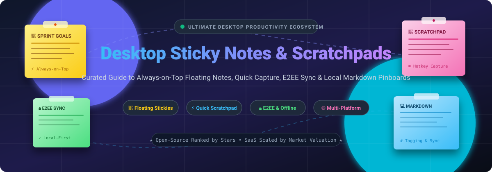

# 📌 Awesome Productivity & Desktop Sticky Notes Ecosystem 🚀

  

  
  
  
  
  
  

---

## 📖 Comprehensive Guide to Desktop Sticky Notes & Digital Scratchpads 💡

Welcome to the definitive **SEO-curated guide and ecosystem index** for **Desktop Sticky Notes, Quick-Capture Scratchpads, Markdown Pinboards, and Cross-Platform Note Synchronization**.

Whether you need a lightweight, always-on-top sticky note widget for Windows/macOS/Linux, an end-to-end encrypted (E2EE) self-hosted privacy vault, or a multi-device synced SaaS clipboard, this index provides transparent pricing tiers, free forever limits, verified company valuations, and GitHub star metrics for active open-source repositories.

---

## 📑 Table of Contents
- [Sector Overview & Market Dynamics](#-sector-overview--market-dynamics)
- [SaaS & Hosted Platforms (Ranked by Scale / Valuation)](#-saas--hosted-platforms)
- [Open-Source GitHub Projects (Ranked by Stars)](#-open-source-github-projects)
- [Comparison Matrix: Desktop Sticky Note Paradigms](#-comparison-matrix-desktop-sticky-note-paradigms)
- [How to Contribute](#-how-to-contribute)
- [Support & Community](#-support)
- [Star History](#-star-history)
- [Disclaimer & Security Considerations](#-disclaimer)

---

## 📊 Sector Overview & Market Dynamics

The global note-taking and personal productivity software market is valued at approximately **$7.35 billion (2024–2026)** and is projected to expand at a compound annual growth rate (**CAGR**) of **14.2%** to exceed **$17 billion by 2032**. 

The sector exhibits **moderate fragmentation with strong barbell concentration**: big-tech operating system incumbents (Apple, Microsoft, Google) command the default pre-installed distribution channel for basic floating desktop stickies, while enterprise workspace consolidators (Notion, Evernote/Bending Spoons) capture multi-billion-dollar commercial workflows. Simultaneously, rising concerns around telemetry and AI cloud scraping have spurred a thriving fragmented long-tail of local-first, zero-knowledge encrypted open-source desktop utilities (Memos, Joplin, Notesnook, Heynote) satisfying power users, developers, and privacy-conscious professionals.

---

## ☁️ SaaS & Hosted Platforms

> Listed in descending order of parent company size, enterprise valuation, or annual recurring revenue.

| Product / Service 🏷️ | Pricing (Starting Paid Tier) 💳 | Free Tier Limits (Exact Allowance & Trial) 🎁 | Company Scale (Revenue / Valuation) 🏢 | Key Features & Platform Highlights 🌟 |
| :--- | :--- | :--- | :--- | :--- |
| **[Apple Notes](https://www.icloud.com)** | **$0.99/mo** (iCloud+ 50GB storage upgrade) | **Free forever with 5 GB** iCloud account storage; unlimited local offline notes on macOS & iOS | **~$3.4 Trillion Market Cap** ($391B Annual Revenue) | Native macOS/iOS deep integration, instant Quick Notes hot corners, rich handwriting, tags, and document scanning. |
| **[Microsoft Sticky Notes](https://www.microsoft.com/en-us/p/microsoft-sticky-notes/9nblggh4qdq4)** | **$6.99/mo** (Microsoft 365 Personal; standalone app is $0) | **100% Free forever** with free Microsoft personal account (5 GB OneDrive sync quota) | **~$3.1 Trillion Market Cap** ($245B Annual Revenue) | Native Windows desktop floating note widgets, ink/stylus support, rich text formatting, and seamless OneNote sync. |
| **[Google Keep](https://keep.google.com)** | **$1.99/mo** (Google One 100GB plan) | **100% Free forever** pooled across standard 15 GB Google Account storage | **~$2.1 Trillion Market Cap** (Alphabet; $350B Annual Revenue) | Instant web and mobile scratchpad, visual color coding, OCR image text recognition, audio memos, and collaborative checklist labels. |
| **[Post-it App (3M)](https://www.post-it.com/3M/en_US/post-it/ideas/app/)** | **Free / Ad-supported** (Enterprise custom kits from $15/user) | **100% Free forever** for digitizing and capturing up to 200 physical Post-it notes per board | **~$70 Billion Market Cap** (3M Company; $32B Annual Revenue) | Digitize real-world physical sticky notes via camera capture; export interactive stickies directly to Miro, Trello, PDF, and PowerPoint. |
| **[Zoho Notebook](https://www.zoho.com/notebook/)** | **$1.99/mo** (Notebook Pro billed annually at $19.99/yr) | **Free forever** with 2 GB cloud sync storage, unlimited total notes, and 500 MB max note size | **~$1.0 Billion Annual Revenue** (Bootstrapped; privately held by Zoho Corp) | Aesthetic visual card notebooks, dedicated audio cards, sketch pads, file attachments, and lockable secure notes. |
| **[Notion](https://www.notion.so)** | **$10/user/mo** ($8/user/mo billed annually - Plus Plan) | **Free forever** for individuals; unlimited note blocks, 5 MB file upload limit, up to 10 guest collaborators | **~$10.0 Billion Valuation** ($300M+ ARR; private unicorn backed by Sequoia) | Connected workspace combining lightweight quick-capture scratchpads with relational databases, Kanban boards, and team wikis. |
| **[Evernote](https://evernote.com)** | **$14.99/mo** ($129.99/yr billed annually - Personal Plan) | **Free forever tier restricted** to 1 notebook, 50 notes maximum, and 1 synced device (14-day free trial on paid plans) | **~$100M+ Annual Revenue** (Acquired by Bending Spoons; valuation ~$2.5B parent) | Full-featured legacy note workspace with web clipper, optical OCR scanning, scratchpad widgets, and task reminders. |
| **[Standard Notes](https://standardnotes.com)** | **$15/mo** (Productivity Tier billed annually at $90/yr) | **Free forever** with unlimited plain text notes, audited end-to-end encryption, and unlimited device synchronization | **~$15M+ Valuation** (Acquired by Proton AG; 100M+ registered Proton users) | Maximum privacy zero-knowledge note vault featuring client-side XChaCha20-Poly1305 encryption and offline-first persistence. |
| **[Simplenote](https://simplenote.com)** | **100% Free / $0** (Sustained by Automattic corporate operations) | **100% Free forever** with unlimited notes, unlimited device sync, and complete note revision history sliders | **~$3.0 Billion Valuation** (Automattic Inc.; parent of WordPress.com) | Pure distraction-free Markdown notepad with instantaneous cross-platform synchronization and zero ads or subscription paywalls. |
| **[Sticky Notes Pro](https://www.stickynotespro.com)** | **$9.99 one-time** lifetime license (Desktop Pro edition) | **30-Day fully functional Free Trial**; freemium tier limited to 3 active pinned desktop sticky notes | **<$5 Million Valuation** (Independent bootstrapped micro-SaaS software studio) | Traditional desktop utility with customizable sticky themes, desktop pinboard alarms, multi-monitor pinning, and export tools. |

---

## 💻 Open-Source GitHub Projects

> Ranked in descending order of GitHub community GitHub_Stars ⭐. Stars_Badges link directly to each repository's stargazers page.

| Repository 📂 | GitHub_Stars ⭐ | Primary Tech Stack 🛠️ | Description & Architecture Highlights 📝 |
| :--- | :--- | :--- | :--- |
| **[usememos/memos](https://github.com/usememos/memos)** |  | Go, React, SQLite, Tailwind | Privacy-first, lightweight self-hosted memo hub and Google Keep alternative with a clean microblogging timeline and Markdown support. |
| **[laurent22/joplin](https://github.com/laurent22/joplin)** |  | TypeScript, React Native, Electron | Robust note-taking and to-do application with complete end-to-end encryption (E2EE), Markdown editor, web clipper, and sync via Nextcloud/S3/Dropbox. |
| **[logseq/logseq](https://github.com/logseq/logseq)** |  | ClojureScript, Electron | Local-first, privacy-focused outliner and personal knowledge base supporting daily journals, scratchpads, bidirectional graph links, and PDF annotations. |
| **[zadam/trilium](https://github.com/zadam/trilium)** |  | JavaScript, Node.js, Electron | Hierarchical personal knowledge base and desktop note organizer with deep note trees, scripting, encryption, and self-hosted server sync. |
| **[super-productivity/super-productivity](https://github.com/super-productivity/super-productivity)** |  | TypeScript, Angular, Electron | Advanced personal productivity tool, to-do list manager, and desktop scratchpad with Jira, GitHub, and GitLab integrations without tracking. |
| **[xournalpp/xournalpp](https://github.com/xournalpp/xournalpp)** |  | C++, GTK 3 | Handwriting, stylus sketchpad, and PDF annotation suite supporting desktop sticky annotations, pressure-sensitive pens, and audio recording. |
| **[streetwriters/notesnook](https://github.com/streetwriters/notesnook)** |  | TypeScript, React Native, Monorepo | Fully open-source, zero-knowledge encrypted private note app engineered as a modern, private alternative to Evernote and Microsoft OneNote. |
| **[blinkospace/blinko](https://github.com/blinkospace/blinko)** |  | TypeScript, Next.js, PostgreSQL | Modern open-source AI-enhanced card note scratchpad prioritizing privacy; designed for quick capture of fleeting thoughts with semantic search. |
| **[xwmx/nb](https://github.com/xwmx/nb)** |  | Bash, Pandoc, Git | Command-line note-taking, bookmarking, and desktop archiving tool packaged in a single portable script with Git syncing and tag filtering. |
| **[standardnotes/app](https://github.com/standardnotes/app)** |  | TypeScript, React, React Native | Desktop, web, and mobile open-source client for Standard Notes; provides audited end-to-end encryption with extensible modular editors. |
| **[silverbulletmd/silverbullet](https://github.com/silverbulletmd/silverbullet)** |  | TypeScript, Deno | Extensible, local-first personal note pad and malleable knowledge base powered by pure Markdown files, live queries, and Lua scripting. |
| **[pbek/QOwnNotes](https://github.com/pbek/QOwnNotes)** |  | C++, Qt 5/6 | Open-source plain-text file notepad and to-do manager for Linux, macOS, and Windows with optional Nextcloud / ownCloud integration. |
| **[heyman/heynote](https://github.com/heyman/heynote)** |  | JavaScript, Electron, CodeMirror | Dedicated scratchpad for developers and power users featuring persistent buffer blocks, automatic formatting, syntax highlighting, and math eval. |
| **[Automattic/simplenote-electron](https://github.com/Automattic/simplenote-electron)** |  | JavaScript, React, Electron | Official cross-platform desktop client for Simplenote with clean Markdown preview, tag organization, and instant cloud sync. |
| **[Beaver-Notes/Beaver-Notes](https://github.com/Beaver-Notes/Beaver-Notes)** |  | JavaScript, Electron | Privacy-respecting, local-first desktop workspace and sticky note scratchpad for macOS, Linux, and Windows with zero telemetry. |
| **[nextcloud/notes](https://github.com/nextcloud/notes)** |  | PHP, Vue.js | Distraction-free, self-hosted note management app for the Nextcloud personal cloud ecosystem with full category and Markdown support. |
| **[linuxmint/sticky](https://github.com/linuxmint/sticky)** |  | Python, GTK 3 | Official Linux Mint desktop sticky notes application with colored note canvases, desktop pinning, spell checking, and tray dock integration. |
| **[HimaSphere/BetterStickies](https://github.com/HimaSphere/BetterStickies)** |  | C#, WPF, .NET | Modern desktop sticky notes application for Windows featuring customizable canvas backgrounds, reminders, tabbed notes, and audio attachments. |

---

## ⚡ Comparison Matrix: Desktop Sticky Note Paradigms

| Paradigm 🎯 | Best Suited For 👤 | Primary Advantages 🌟 | Key Limitations ⚠️ | Top Recommended Tools 🏆 |
| :--- | :--- | :--- | :--- | :--- |
| **Always-on-Top Floating Stickies** | Multitaskers, quick phone notes, scratch calculation | Floating windows, instant glanceability, zero boot time | Screen clutter on single monitors, basic formatting | *Microsoft Sticky Notes*, *BetterStickies*, *Linux Mint Sticky* |
| **Local-First Developer Scratchpads** | Engineers, terminal users, JSON/SQL formatting | Persistent buffers, syntax highlight, instant launch | Lack of built-in mobile synchronization | *Heynote*, *nb*, *Beaver Notes*, *FromScratch* |
| **Self-Hosted Privacy Pinboards** | Homelabbers, privacy advocates, team intranets | Complete data ownership, Docker deployment, REST APIs | Requires self-managed server setup and backup | *Memos*, *Nextcloud Notes*, *Trilium* |
| **End-to-End Encrypted Note Vaults** | Writers, researchers, confidential work notes | Zero-knowledge cryptography, cross-device sync | Slower raw launch time compared to plain stickies | *Joplin*, *Notesnook*, *Standard Notes* |

---

## 🤝 How to Contribute

Contributions are warmly welcomed! Help keep this curated list up to date and accurate:

1. 🍴 **Fork the repository** on GitHub.
2. 🌿 **Create a new branch** (`git checkout -b feature/add-new-note-tool`).
3. ✍️ **Add or update an entry** in `README.md`:
   - For SaaS tools: Include specific pricing tiers, explicit free tier limits, company valuation, and factual descriptions.
   - For Open-Source tools: Include valid GitHub links, accurate Stars_Badges linked to stargazers, and tech stack tags.
4. 🧪 **Check Markdown formatting** and ensure table alignments remain pristine.
5. 🚀 **Submit a Pull Request** with a descriptive summary of your additions.

---

## 💖 Support

If you find this ecosystem index helpful for discovering productivity software and desktop tools, please consider supporting the project:

- ⭐ **Star this repository** to help others discover it.
- 🍴 **Fork and contribute** new desktop sticky apps and scratchpad utilities.
- 📢 **Share with colleagues, developers, and productivity communities.**
- ☕ **Sponsor the maintainer / Buy a coffee**: Support ongoing open-source curation on the [GitHub Sponsors Dashboard](https://github.com/sponsors/ishandutta2007)!

---

## 📈 Star History

---

## 🛡️ Disclaimer

- This repository is a **community-curated index** created for educational and informational purposes; inclusion does not constitute a formal commercial endorsement.
- **Security Notice**: Desktop sticky notes are frequently utilized to jot down transient passwords, API secrets, or credentials. Always avoid storing unencrypted plain-text secrets on shared machines, and leverage audited end-to-end encrypted tools (such as Joplin, Notesnook, or Standard Notes) for confidential operational data.
